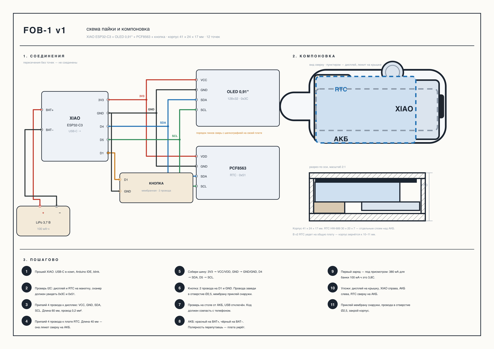
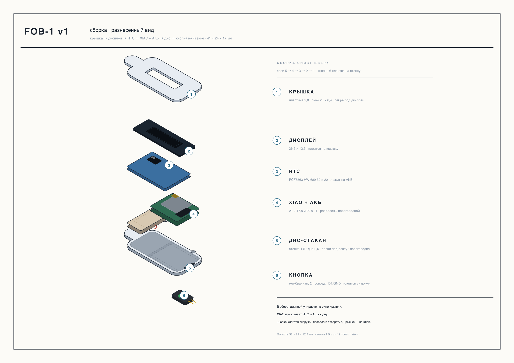
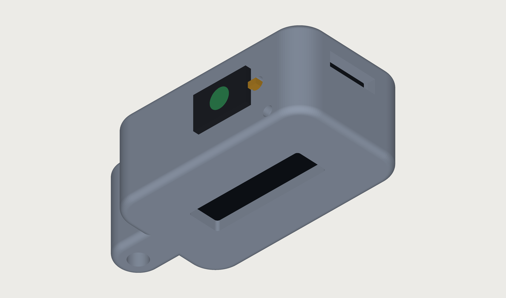
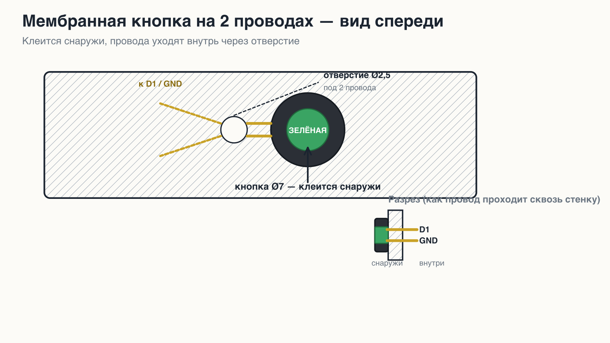

# FOB-1 — аппаратный TOTP-брелок

Автономный генератор одноразовых паролей (TOTP) в корпусе-брелоке.
Код считается на устройстве (XIAO ESP32-C3) и показывается на OLED;
точное время держит отдельная микросхема часов PCF8563.
Телефон и сеть для работы не нужны.

**Корпус:** 41 × 24 × 17 мм (с проушиной 49,3 мм), PETG, 2 детали.
**Питание:** LiPo 3,7 В 100 мА·ч (401120, 20 × 11 × 4), зарядка по USB-C.

## Возможности

- TOTP, 6 цифр, окно 30 с
- OLED 0,91″ 128×32, SSD1306 (I2C, 0x3C)
- RTC PCF8563 (I2C, 0x51) + кварц 32,768 кГц
- Одна **мембранная кнопка на 2 проводах** (D1 + GND)
- Сон, пробуждение по кнопке

## Распиновка (XIAO ESP32-C3)

| Пин XIAO | GPIO | Куда |
|---|---|---|
| 3V3 | — | OLED VCC, RTC VDD |
| GND | — | OLED GND, RTC GND, кнопка (провод 2) |
| D4 | GPIO6 | I2C **SDA** → OLED SDA, RTC SDA |
| D5 | GPIO7 | I2C **SCL** → OLED SCL, RTC SCL |
| D1 | GPIO3 | Кнопка (провод 1) |
| BAT+ | — | АКБ + |
| BAT− | — | АКБ − |

Кнопка: `INPUT_PULLUP`, активный уровень LOW.

## Комплектующие

| # | Позиция | Параметры | Кол-во |
|---|---|---|---|
| 1 | МК | XIAO ESP32-C3 (21 × 17,8 мм) | 1 |
| 2 | Дисплей | OLED 0,91″ 128×32, SSD1306, I2C | 1 |
| 3 | Часы | PCF8563 HW-689 30 × 20 | 1 |
| 4 | Кварц | 32,768 кГц, 3215 | 1 |
| 5 | АКБ | LiPo 3,7 В, 100 мА·ч (401120, 20 × 11 × 4), с PCM | 1 |
| 6 | Кнопка | мембранная, 2 провода (готовая) | 1 |
| 7 | Провод | МГТФ 0,2 мм², ~1 м | 1 |
| 8 | Корпус | PETG, 2 детали | 1 |
| 9 | Люверс | Ø3,6 × 2,0, латунь | 1 |
| 10 | Кольцо | разрезное, 25 мм | 1 |

Полная спецификация с ценами: [`BOM_FOB-1.csv`](BOM_FOB-1.csv).

## Схема пайки



## Сборка (разнесённый вид)



## 3D-вид



## Узел мембранной кнопки

Кнопка приклеивается **снаружи** на переднюю стенку, два её провода
заводятся внутрь через отверстие Ø2,5 и припаиваются к D1 и GND.



## Структура репозитория

```
.
├── v1_full.py                 # 3D-модель корпуса (CadQuery) → STEP/STL
├── parts/                     # готовые модели для печати
│   ├── v1_back.step / .stl    # дно-стакан (с отверстием под провода)
│   └── v1_cover.step / .stl   # крышка с окном дисплея
├── wiring.py                  # схема пайки и компоновка
├── iso.py                     # изометрия сборки
├── membrane_2wire_diagram.py  # схема узла кнопки
├── build_doc.py               # сборка .docx
├── render_final.py            # 3D-рендер
├── BOM_FOB-1.csv              # спецификация
├── FOB-1_dokumentaciya.docx   # техническая документация
└── build.sh                   # пересборка всех артефактов
```

## Пересборка

```bash
python3 -m venv .venv && source .venv/bin/activate
pip install -r requirements.txt

./build.sh                 # или: PY=.venv/bin/python ./build.sh
```

`build.sh` требует `rsvg-convert` (librsvg) для SVG → PNG.

## Лицензия

MIT — см. [`LICENSE`](LICENSE).
